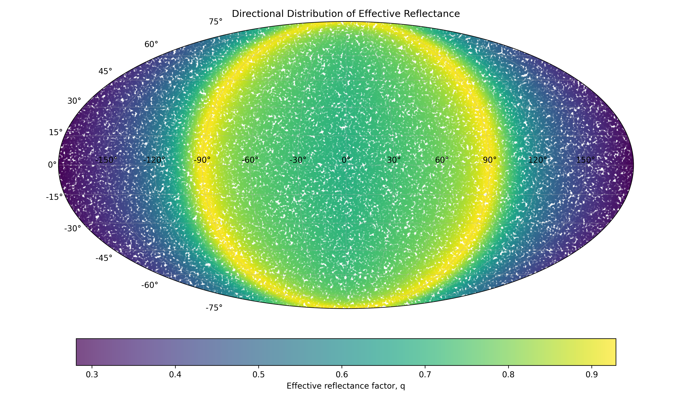

# Effective Solar Reflectance Factor — [ROSPIN-SAT-1](https://www.rospin.org/rospin-sat-1)

<p align="center">
  
</p>

<p align="center">
  <i>Directional distribution of the effective spacecraft reflectance over uniformly sampled solar propagation directions.</i>
</p>

## Overview

<p align="justify"> 
This repository contains the numerical implementation of a spacecraft optical model to estimate the effective solar reflectance factor of the ROSPIN-SAT-1 spacecraft for solar-radiation-pressure analysis.</p> 

<p align="justify"> 
The model combines wavelength-dependent Fresnel reflection, ASTM E490 AM0 solar spectral weighting, optical properties of the spacecraft surface materials, and projected-area weighting of the external spacecraft geometry. For each solar illumination direction, the reflectance of the illuminated surfaces is evaluated spectrally and combined into a spacecraft-level effective reflectance factor. Since no fixed spacecraft attitude profile is assumed, the directional dependence of the reflectance is characterized using Monte Carlo sampling of solar propagation directions uniformly distributed over the unit sphere. This allows the model to quantify not only a nominal reflectance factor, but also its variation with illumination direction and the corresponding statistical distribution. The implementation was developed together with a complete analytical derivation, numerical verification, convergence analysis, and evaluation of the main modelling assumptions. The associated technical report provides the full physical formulation, spacecraft surface model, validation procedure, numerical results, and limitations of the current approach.</p>


## Main Result

For **100,000 sampled solar propagation directions**:

| Quantity | Value |
|---|---:|
| Mean reflectance | **0.667812** |
| Median | 0.723773 |
| 95th percentile | 0.904695 |

### Nominal effective reflectance

**q_nominal ≈ 0.67**

For the simplified SRP formulation used in this work:

**CR = 1 + q ≈ 1.67**

## Technical Report

The complete derivation, numerical methodology, spacecraft geometry, verification procedure, results, and limitations are presented in:

### [Numerical Estimation of the Effective Solar Reflectance Factor](ROSPIN-SAT-1_Effective_Reflectance_Analysis.pdf)

*ROSPIN-SAT-1 Technical Analysis Report*

## Build

Requires a C++17-compatible compiler.

```bash
g++ -std=c++17 -O3 src/main.cpp include/solver.cpp -o main
```